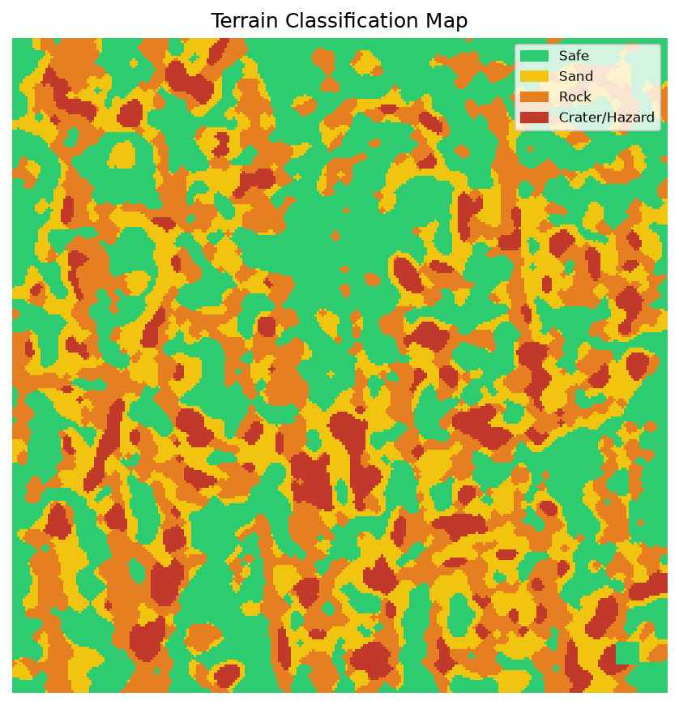
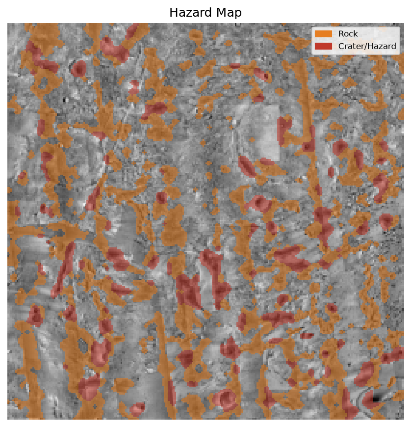
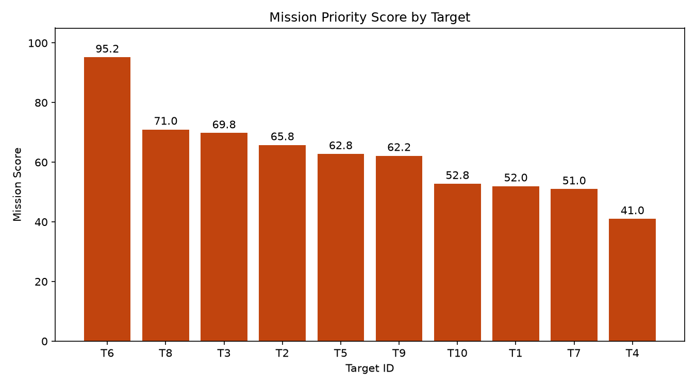
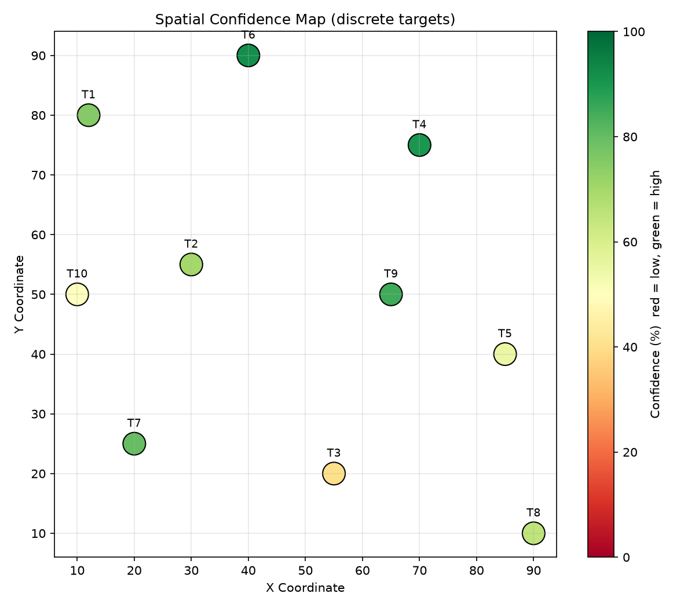
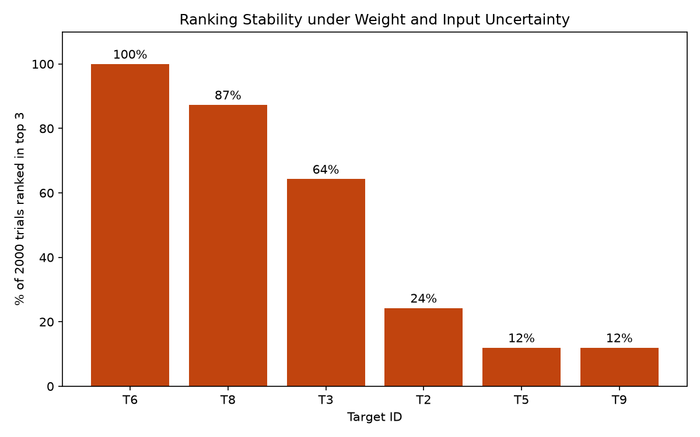

# MARS-09: Autonomous Rover Mission Planner for Jezero Crater

> Turns real NASA/USGS Mars orbital data into a hazard map, a safe rover route and a ranked list of science targets, all shown in one mission dashboard.

**Track A: Rover Exploration** | Built at HackInnovision by a team of four


---

## Overview

A rover on Mars cannot be joysticked from Earth, so it has to understand its terrain, plan a safe route and decide where science is worth the risk. MARS-09 is a complete pipeline for that problem, built on real orbital data of **Jezero Crater**, the landing site of NASA's Perseverance rover.

1. **Perception:** reads a CTX orbital image and a matching elevation model, then classifies every cell as safe, sand, rock or hazard.
2. **Navigation:** turns the terrain into a cost map, finds a safe route with A\*, and re-plans around a newly detected hazard.
3. **Science discovery:** ranks candidate exploration sites by scientific value, ice potential, terrain risk and uncertainty.
4. **Dashboard:** one Streamlit app that shows terrain, route, targets and 3D elevation to a mission operator.

## Key results (Jezero Crater, about 32 km x 30 km)

| Item | Result |
|---|---|
| Input data | CTX mosaic (6 m/pixel, 5040 x 5322) + CTX elevation model (20 m/pixel, 1512 x 1596) |
| Analysis grid | 256 x 256 cells (about 125 m per cell) |
| Elevation range | -2710 m to -1515 m |
| Terrain split | Safe 47.8% / Sand 24.5% / Rock 18.4% / Hazard 9.3% |
| Slope | Median 3.5 deg, 90th percentile 11.2 deg, 99th percentile 20.1 deg; 4.3% of cells steeper than 15 deg |
| Route | 353 cells, risk score 673, 0 hazard cells crossed |
| Science | Top 10 ranked targets with uncertainty and rank-stability analysis |
| Integration | `check_all.py` runs 32 checks across all modules, all passing |

## How it works

```
 NASA/USGS CTX mosaic + CTX DEM (Mars Trek) (use .tir file extension)
                  |
                  v
     perception.py  (Terrain & Hazard)
        |  outputs/terrain_classes.npy, slope_map.npy,
        |  elevation_map.npy, confidence_map.npy
        |
        +----------------------+-------------------------+
        v                      v                         v
 navigation_pipeline.py   science_scoring/          terrain_3d.py
 (cost map, A*, energy)   (target ranking,          (3D elevation
        |                  uncertainty)               model)
        |                      |                         |
        +----------------------+-------------------------+
                               v
                  app.py  (Streamlit mission dashboard)
```

### Shared data contract

Every module agrees on the same grid, so outputs plug together with no conversion.

| Item | Value |
|---|---|
| Grid size | 256 x 256 |
| Terrain IDs | `0` safe, `1` sand, `2` rock, `3` hazard |
| Coordinates | `(row, col)` |
| Start / Goal | `(10, 10)` and `(240, 240)`, defined in `config.py` |

---

## Modules

### 1. Terrain & Hazard Intelligence (`perception.py`, `terrain_3d.py`)

1. Resample the image and the elevation model onto the shared 256 x 256 grid.
2. Measure brightness, edge strength and local roughness per cell. Features are computed at 1024 px and then shrunk, so texture is not averaged away. Brightness seams between mosaic strips are removed.
3. Cluster cells with K-means (k = 4) and label the groups Safe / Sand / Rock / Hazard by roughness.
4. Compute **slope from the elevation model at its full 20 m resolution**, then resample. Cells steeper than **15 deg** become hazards. The threshold is a tunable assumption.
5. Force start and goal cells to safe.
6. Save a confidence map (distance to the cluster centre) for the uncertainty analysis.

**Outputs** (`mars-rover/outputs/`): `terrain_classes.npy`, `classes_image_only.npy`, `slope_map.npy`, `elevation_map.npy`, `confidence_map.npy`, `terrain_map.png`, `hazard_map.png`, `elevation_check.png`. `terrain_3d.py` builds interactive 3D models (colored by elevation or by hazard).

| Terrain map | Hazard map |
|---|---|
|  |  |


### 2. Navigation & Path Planning (`cost_mapper.py`, `path_planner.py`, `energy_estimator.py`, `navigation_pipeline.py`)

- Converts terrain classes into a **cost map**. Hazard cells are impassable.
- Finds the lowest-risk route from start to goal with **A\***.
- **Re-plans** an alternate route after a simulated newly detected hazard on the primary route.
- Reports path length and risk score, and estimates **energy use (Wh)** and battery feasibility.
- Can route through science-target waypoints (`science_targets.json`).

**Outputs:** `cost_map.npy`, `planned_path.json`.

### 3. Science Discovery & Uncertainty (`science_scoring/`)

- Scores candidate exploration sites on **scientific value, ice probability, terrain risk, uncertainty and confidence**, and combines them into a mission score.
- Produces a **Top 10 ranking** (`ranked_targets.csv`) and a written recommendation (`recommendation.txt`).
- **Robustness analysis:** checks how stable the ranking is when the weights change (`rank_stability.csv`, `rank_stability.png`).
- Maps where the estimates are least certain (`spatial_confidence_map.png`).
- Unit tests in `test_science.py`.

| Target scores | Uncertainty map |
|---|---|
|  |  |



### 4. Dashboard & Integration (`app.py`, `run_all.py`, `check_all.py`)

- **`app.py`:** Streamlit dashboard with Mission Overview, Terrain Analysis, Navigation and Science Targets views.
- **`run_all.py`:** runs terrain, navigation and the integration check in one command.
- **`check_all.py`:** verifies the whole pipeline: grid shapes, class IDs, start and goal, route validity (starts at START, ends at GOAL, no hazard cells), target table and required files.

---

## Run it

**Requirements:** Python 3.10+

```bash
git clone https://github.com/theemusk/hackinnovision.git
cd hackinnovision/mars-rover
python -m venv .venv
.venv\Scripts\activate          # Windows  (macOS/Linux: source .venv/bin/activate)
pip install -r requirements.txt
```

**Get the data** (about 30 MB, not stored in git): in [NASA Mars Trek](https://trek.nasa.gov/mars) add these two layers to Downloads for the same area, then save them as shown:

| Mars Trek layer | Save as |
|---|---|
| MRO CTX, Jezero Mosaic, Controlled | `data/mars_mosaic.tif` |
| MRO CTX, Jezero DEM, Controlled | `data/mars_dem.tif` |

**Run the pipeline and open the dashboard:**

```bash
python run_all.py          # terrain -> navigation -> integration check
streamlit run app.py       # mission dashboard (opens in the browser)
python terrain_3d.py       # optional: standalone 3D HTML models in outputs/
```

If the two `.tif` files are missing, `run_all.py` skips the terrain step and uses the committed files in `outputs/`, so the dashboard still works.

## Data sources and credits

- **Imagery and elevation:** NASA/JPL Mars Reconnaissance Orbiter **CTX** (Context Camera) mosaic and CTX digital elevation model of Jezero Crater, produced by the **USGS Astrogeology Science Center**, accessed through **NASA Mars Trek**.
- Data credit belongs to NASA/JPL-Caltech and the USGS. Used here for educational and hackathon purposes.

## Assumptions and limitations

- Terrain classes are **proxies from image texture and slope**, not geologically verified labels. There is no ground-truth map for validation, so results were checked visually against the imagery and elevation.
- The **15 deg slope limit** is a tunable assumption, not an official NASA threshold.
- The 20 m elevation model captures crater walls and large slopes but **cannot resolve individual boulders**.
- The confidence map is a clustering-distance heuristic, **not a calibrated probability**.
- The 256 x 256 grid is a speed/detail trade-off (about 125 m per cell). The area is slightly stretched to fit the square grid, equally for image and elevation, so the layers stay aligned.
- The analysis is a **static snapshot**. A real rover would update the map from onboard sensors.

## Future work

- Use HiRISE data for boulder-scale hazards and finer routes.
- Train a learned terrain classifier on labeled Mars data to replace the clustering step.
- Add slope-dependent and wheel-slip energy models, and multi-sol mission planning with recharging.
- Live threshold sliders in the dashboard to show how hazard assumptions change routes.
- Apply the pipeline to other regions (only the two input layers change).

## Repository structure

```
hackinnovision/
├── README.md
├── docs/                          # screenshots used in this README
└── mars-rover/
    ├── config.py                  # shared grid, start/goal, class IDs
    ├── perception.py              # terrain + hazard classification
    ├── terrain_3d.py              # 3D elevation/hazard models
    ├── cost_mapper.py             # terrain -> cost map
    ├── path_planner.py            # A* and route metrics
    ├── energy_estimator.py        # traverse energy estimate
    ├── navigation_pipeline.py     # full navigation run
    ├── science_scoring/           # target scoring, uncertainty, robustness, tests
    ├── app.py                     # Streamlit dashboard
    ├── run_all.py                 # one-command pipeline
    ├── check_all.py               # integration checker
    ├── requirements.txt
    ├── data/                      # input .tif files (not in git)
    └── outputs/                   # generated maps, grids and images
```

## Team

| Role | Module | Name |
|---|---|---|
| Member 1 | Terrain & Hazard Intelligence | [name] |
| Member 2 | Navigation & Path Planning | [name] |
| Member 3 | Science Discovery & Uncertainty | [name] |
| Member 4 | Dashboard, Integration & Presentation | [name] |